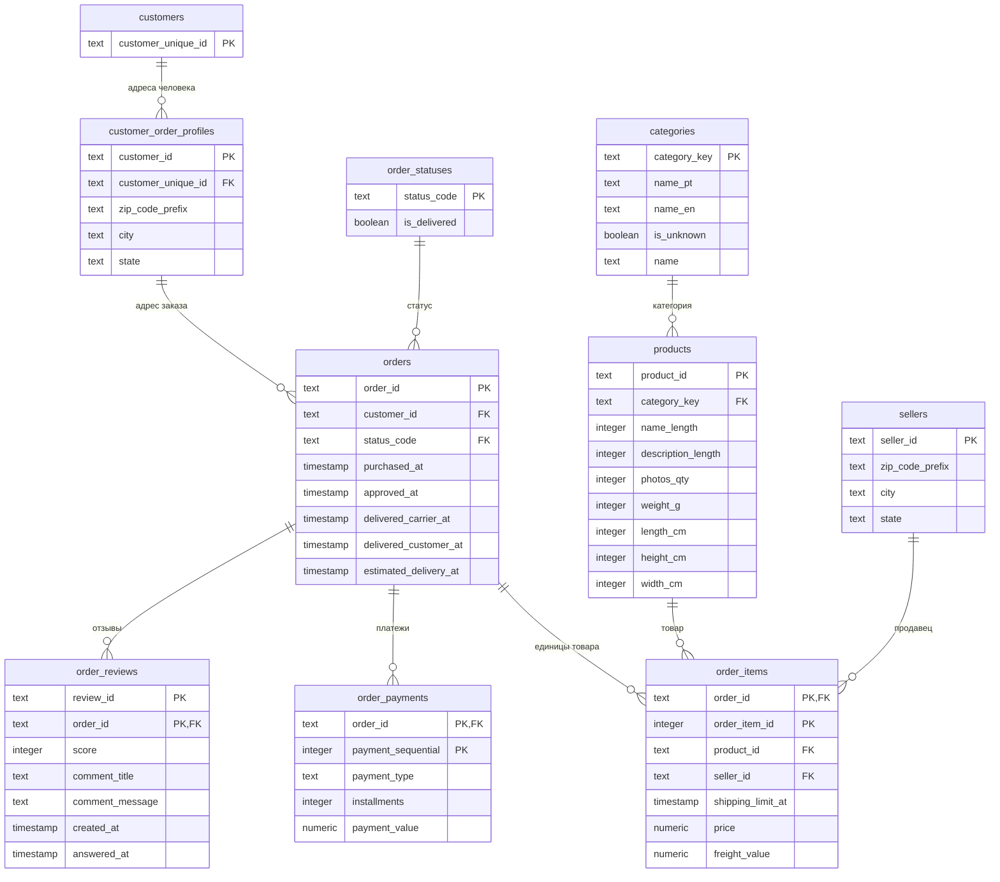

# Модель данных

Описание схем `core` и `mart`: что означает одна строка каждой таблицы,
какой у неё ключ и почему так. Код — в [model/](../model/).

Модель собрана из трёх веток команды: основа — `pers-BezRiska`
(на базе модели из `kgalanova`), в неё перенесены сильные стороны `main`.
Что откуда взято, описано в конце документа.

## Как устроена сборка

```
raw  ──02_load──▶  core  ──03_marts──▶  mart
(как пришло)       (типы, ключи,        (готовые наборы
                    связи)               для отчётов)
```

| Файл | Что делает |
|---|---|
| `00_reset.sql` | Удаляет и заново создаёт схемы `core` и `mart` |
| `01_schema.sql` | Таблицы `core` с ключами, связями и ограничениями |
| `02_load.sql` | Переносит данные из `raw` с приведением типов |
| `03_marts.sql` | Представления `mart` |
| `90_checks.sql` | 26 проверок: строки, суммы, разрезы выручки, календарь, качество. Падает, если что-то не сошлось |

`build.sh` выполняет все файлы **одной транзакцией**. Если ошибка случится
в любом месте, даже после удаления схем, изменения откатятся целиком,
и в базе останется прежняя рабочая версия модели. Это проверено тестами
на четырёх видах плохих данных.

## Схема core

`PK` — первичный ключ, `FK` — внешний ключ. Линия `||--o{` означает
«одна строка слева — ноль или много строк справа».



Отдельно от связей стоит календарь `calendar` (одна строка = один день):
отчёты по периодам строятся от него. Служебные поля происхождения
`source_file` и `loaded_at` у заказов, позиций, платежей и отзывов
на схеме не показаны.

| Таблица | Одна строка — это | Ключ | Строк |
|---|---|---|---|
| `customers` | человек | `customer_unique_id` | 96 096 |
| `customer_order_profiles` | адресная запись покупателя для заказа | `customer_id` | 99 441 |
| `order_statuses` | статус заказа + флаг «доставлен» | `status_code` | 8 |
| `categories` | категория товара, включая `__unknown__` | `category_key` | 74 |
| `products` | карточка товара | `product_id` | 32 951 |
| `sellers` | продавец | `seller_id` | 3 095 |
| `orders` | заказ любого статуса | `order_id` | 99 441 |
| `order_items` | **одна единица товара** в заказе | `(order_id, order_item_id)` | 112 650 |
| `order_payments` | платёжная запись заказа | `(order_id, payment_sequential)` | 103 886 |
| `order_reviews` | отзыв на заказ | `(review_id, order_id)` | 99 224 |
| `calendar` | день | `date` | 821 (сентябрь 2016 — ноябрь 2018) |

## Ключевые решения

**Покупатель — это `customer_unique_id`.** `customer_id` выдаётся новый
на каждый заказ, и по нему все покупатели выглядят разовыми. Человек вынесен
в `customers`, а адрес остался в `customer_order_profiles`: один человек
может заказывать на разные адреса, у каждого заказа свой адрес.

**В `core` лежат заказы всех статусов.** Если отфильтровать недоставленные
при загрузке, потеряем отмены, а с ними и вопросы вида «какая доля отмен».
Правило «выручка = доставленные» задано ровно в одном месте:
`order_statuses.is_delivered`.

**Строка `order_items` — единица товара.** Так устроен источник: три одинаковых
товара — три строки. Мы их не схлопываем. «Строка чека» (товар + продавец)
считается в витрине как `count(DISTINCT (product_id, seller_id))`.

**Позиции, платежи и отзывы не соединяются напрямую.** У них разный уровень,
и прямой JOIN размножит суммы. В `mart.order_totals` каждый из них сначала
сворачивается до заказа, потом присоединяется.

**Категория — по исходному названию, пустая — `__unknown__`.** Текстовый ключ
стабилен между сборками и понятен в отчётах. Товар без категории не теряется,
поэтому сумма по категориям сходится с общей выручкой. Подпись для отчётов
(`categories.name`) задана один раз: перевод, иначе португальское название,
иначе `unknown`.

**Отчёты по периодам строим от календаря.** Ноябрь 2016 без заказов должен
быть в отчёте с нулём, а не пропасть.

**Деньги — `numeric`, валюта источника — BRL.** Во float сравнение сумм
с точностью до копейки даёт случайный результат.

**Время — исходное локальное, без часового пояса.** Часовой пояс в данных
не указан, и мы его не додумываем.

**Нет данных ≠ ноль.** У заказа без позиций сумма в витрине `NULL`, а не 0:
мы не знаем, сколько он стоил. А вот количества (единиц, платежей, отзывов)
при отсутствии строк равны 0: «ни одной строки» — это известный факт.

## Витрины mart

| Витрина | Одна строка — это | Зачем |
|---|---|---|
| `order_totals` | заказ | Чек, единицы и строки, оплата и её расхождение с чеком, сроки и опоздание, число отзывов и последняя оценка |
| `delivered_items` | единица товара доставленного заказа | Здесь применяется правило выручки. Основа для разрезов по продавцам, категориям, месяцам |
| `monthly_sales` | месяц календаря | Доставленные заказы и выручка, включая месяцы без продаж |
| `seller_sales` | продавец с продажами | Заказы, единицы, выручка только по его позициям |
| `category_sales` | категория с продажами | Выручка и доля в общей |
| `customers` | человек | Число заказов, первый и последний заказ, выручка. Для вопросов про удержание |
| `quality_issues` | одна проблема одной сущности | Реестр проблем из [data_issues.md](data_issues.md) с уровнем `error` / `warning` / `info` |

Витрины — представления (view): данные не копируются, а считаются из `core`,
поэтому не могут разойтись с моделью.

## Проверки

**При каждой сборке** (`model/90_checks.sql`) `core` и `mart` сравниваются
с `raw`, а не с контрольными цифрами задания. Поэтому проверки работают
и на новой выгрузке:

- число строк в каждой таблице совпадает с источником;
- людей столько же, сколько уникальных `customer_unique_id`;
- у каждого товара та же категория, что в источнике;
- суммы `price`, `freight_value`, `payment_value` совпадают до копейки;
- витрина заказов не теряет и не размножает заказы, деньги, платежи и отзывы;
- выручка одинакова во всех разрезах: по позициям, продавцам, категориям,
  месяцам, покупателям;
- в календаре нет пропущенных дней, и он покрывает все покупки;
- в реестре качества нет проблем уровня `error`.

**Контрольные цифры задания** проверяет `answers/99_controls.sql` (`make check`).

**Тесты** (`tests/test_model.py`, `make test`) проверяют каждое правило модели
на крошечном искусственном наборе, где ответ известен заранее. Например:
- заказ с 3 позициями, 2 платежами и 2 отзывами не размножает суммы;
- пустой месяц есть в отчёте;
- заказ без платежа даёт `NULL`, а не 0;
- мусор в цене, сирота, повтор ключа и доставленный заказ без позиций
  останавливают сборку, и модель остаётся прежней.

Тесты работают во временной базе и удаляют её за собой.

## Откуда что взято

Основа — модель из ветки `kgalanova`, упрощённая в `pers-BezRiska`. В неё
перенесены сильные стороны `main`.

| Что | Откуда | Почему так |
|---|---|---|
| Набор таблиц, составные ключи, профиль адреса отдельно от человека | `kgalanova`, `main` | Обе ветки пришли к одной схеме, расходились в названиях |
| Названия колонок как в источнике (`customer_unique_id`, `order_item_id`, `payment_sequential`) | `pers-BezRiska` | Проще сверять с `raw` и с заданием. В `main` они переименованы (`buyer_id`, `item_number`) |
| Флаг `order_statuses.is_delivered` | `pers-BezRiska` | Правило выручки в одном месте. В `main` `'delivered'` повторялось в нескольких витринах |
| Календарь `core.calendar`, витрина `monthly_sales` | `pers-BezRiska` | Вместо функции `sales_by_month` из `main`: витрину проще объяснить, а календарь пригодится для любых периодов |
| Проверки внутри транзакции сборки | `pers-BezRiska` | В `main` проверки шли отдельным шагом после `COMMIT`, и модель с ошибкой успевала сохраниться |
| Строка чека = товар + продавец | `pers-BezRiska` | В `main` строк и единиц получалось одинаково (1.1422 и 1.1422), а задание просит именно два разных числа |
| Текстовый ключ категории `category_key` и `__unknown__` | `main` | Стабилен между сборками, понятен в отчётах, не нужен трюк `IS NOT DISTINCT FROM` |
| Витрины `seller_sales`, `category_sales`, `customers` | `main` (`buyer_activity` → `customers`) | Ответы становятся короткими, а выручку можно сверить во всех разрезах |
| В `order_totals`: отзывы, последняя оценка, `payment_delta`, `delay_days`, география покупателя | `main` | Для вопросов про доставку и качество обслуживания |
| Уровни `error` / `warning` / `info` в реестре качества | `main` | Критическая проблема останавливает сборку |
| `CHECK` на неотрицательные платежи и рассрочку | `main` | Ошибку ловит сама схема |
| Таймауты блокировок, фиксированный формат дат в сборке | `main` | Сборка не зависнет и не будет зависеть от настроек сервера |
| Тесты на искусственных данных | `main`, адаптированы | Каждое правило модели проверено на случае с заранее известным ответом |
| Своё окружение в репозитории (Docker Compose на порту 5433, `setup.sh`, `.venv`), `Makefile` | `main` | Репозиторий собирается сам, без папки организаторов рядом |
| Выгрузка ответов в CSV/JSON, профиль `raw` в JSON | `main` | Готовые результаты лежат в `artifacts/` |
| Схема пересоздаётся с нуля, проверки обычным SQL без динамического PL/pgSQL | `pers-BezRiska` | Задание требует сборку на чистой базе, а простой код легче объяснить на защите |
| Mermaid-диаграмма вместо PNG | `pers-BezRiska` | PNG из `main` генерировался по старой схеме и требовал Graphviz. Mermaid GitHub рисует сам |
