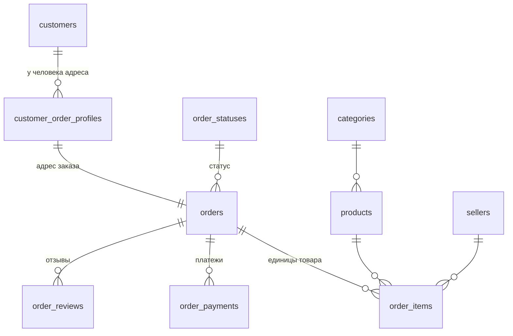

# Модель данных

Описание схем `core` и `mart`: что означает одна строка каждой таблицы,
какой у неё ключ и почему так. Код — в [model/](../model/).

Основа — модель из ветки `kgalanova`. Что мы в ней упростили и почему,
описано в конце документа.

## Как устроена сборка

```
raw  ──02_load──▶  core  ──03_marts──▶  mart
(как пришло)       (типы, ключи,        (готовые наборы
                    связи)               для отчётов)
```

| Файл | Что делает |
|---|---|
| `00_reset.sql` | Удаляет и заново создаёт схемы `core` и `mart` |
| `01_schema.sql` | Таблицы `core` с ключами, связями и ограничениями |
| `02_load.sql` | Переносит данные из `raw` с приведением типов |
| `03_marts.sql` | Представления `mart` |
| `90_checks.sql` | 18 проверок: строки, суммы, связи, календарь. Падает, если что-то не сошлось |

`build.sh` выполняет все файлы **одной транзакцией**. Если ошибка случится
в любом месте, даже после удаления схем, изменения откатятся целиком,
и в базе останется прежняя рабочая версия модели. Это проверено.

## Схема core



| Таблица | Одна строка — это | Ключ | Строк |
|---|---|---|---|
| `customers` | человек | `customer_unique_id` | 96 096 |
| `customer_order_profiles` | адресная запись покупателя для заказа | `customer_id` | 99 441 |
| `order_statuses` | статус заказа + флаг «доставлен» | `status_code` | 8 |
| `categories` | категория товара, включая «не указана» | `category_id` | 74 |
| `products` | карточка товара | `product_id` | 32 951 |
| `sellers` | продавец | `seller_id` | 3 095 |
| `orders` | заказ любого статуса | `order_id` | 99 441 |
| `order_items` | **одна единица товара** в заказе | `(order_id, order_item_id)` | 112 650 |
| `order_payments` | платёжная запись заказа | `(order_id, payment_sequential)` | 103 886 |
| `order_reviews` | отзыв на заказ | `(review_id, order_id)` | 99 224 |
| `calendar` | день | `date` | 821 (сентябрь 2016 — ноябрь 2018) |

## Ключевые решения

**Покупатель — это `customer_unique_id`.** `customer_id` выдаётся новый
на каждый заказ, по нему все покупатели выглядят разовыми. Человек вынесен
в `customers`, а адрес остался в `customer_order_profiles`: один человек
может заказывать на разные адреса, и у каждого заказа свой адрес.

**В `core` лежат заказы всех статусов.** Если отфильтровать недоставленные
при загрузке, потеряем отмены, а с ними и вопросы вида «какая доля отмен».
Правило «выручка = доставленные» задано ровно в одном месте:
`order_statuses.is_delivered`.

**Строка `order_items` — единица товара.** Так устроен источник: три одинаковых
товара — три строки. Мы их не схлопываем. «Строка чека» (товар + продавец)
считается в витрине как `count(DISTINCT (product_id, seller_id))`.

**Позиции и платежи не соединяются напрямую.** У них разный уровень, и прямой
JOIN размножит суммы. В `mart.order_totals` каждый из них сначала
сворачивается до заказа, потом присоединяется.

**Пустая категория — отдельная строка, а не выброшенный товар.** Иначе сумма
по категориям не сойдётся с общей выручкой. Подпись категории
(`categories.name`) задана один раз: перевод, иначе португальское название,
иначе `unknown`.

**Отчёты по периодам строим от календаря.** Ноябрь 2016 без заказов должен
быть в отчёте с нулём, а не пропасть.

**Деньги — `numeric`, не float.** Во float сравнение сумм с точностью
до копейки даёт случайный результат.

**Нет данных ≠ ноль.** У заказа без позиций сумма в витрине `NULL`, а не 0:
мы не знаем, сколько он стоил.

## Витрины mart

| Витрина | Одна строка — это | Зачем |
|---|---|---|
| `order_totals` | заказ | Чек, число единиц и строк, оплата, срок доставки, опоздание. Для вопросов на уровне заказа и покупателя |
| `delivered_items` | единица товара доставленного заказа | Выручка по продавцам, категориям, месяцам |
| `quality_issues` | одна проблема одной сущности | Реестр проблем из [data_issues.md](data_issues.md), чтобы найти конкретные заказы |

Витрины — представления (view): данные не копируются, а считаются из `core`,
поэтому не могут разойтись с моделью.

## Проверки

`90_checks.sql` сравнивает `core` с `raw`, а не с контрольными цифрами задания.
Поэтому проверки работают и на новой выгрузке:

- число строк в каждой таблице совпадает с источником;
- людей столько же, сколько уникальных `customer_unique_id`;
- у каждого товара та же категория, что в источнике;
- суммы `price`, `freight_value`, `payment_value` совпадают до копейки;
- витрины не теряют и не размножают заказы и деньги;
- в календаре нет пропущенных дней, и он покрывает все покупки.

Контрольные цифры задания проверяются отдельно: `answers/99_controls.sql`.

## Что изменили относительно модели kgalanova

| Было | Стало | Почему |
|---|---|---|
| `CREATE TABLE IF NOT EXISTS`, `category_id` сохраняется между сборками | Схема пересоздаётся с нуля | Задание требует сборку на чистой базе. Сохранение состояния усложняет код и не нужно |
| Предварительная валидация `raw` динамическим PL/pgSQL | Ошибки ловят приведение типов, `PRIMARY KEY`, `FOREIGN KEY` и `CHECK` | То же самое, но средствами самой схемы, и это проще объяснить |
| Проверки в цикле с `EXECUTE format(...)` | Таблица проверок обычным SQL + одна проверка в конце | Каждую проверку видно и можно запустить отдельно |
| Advisory lock, `LOCK TABLE` | Убраны | Сборку запускает один человек на локальной базе |
| Строка чека = группировка по товару, продавцу, цене, доставке и сроку | Строка чека = товар + продавец | На данных результат тот же (1.0385), а определение проще |
| Справочник `payment_types` | Убран, тип платежа — текст | Атрибутов у типа нет |
| — | Добавлены `calendar`, `is_late`, `delivery_days`, `purchase_month` | Для новых вопросов про периоды и доставку |
