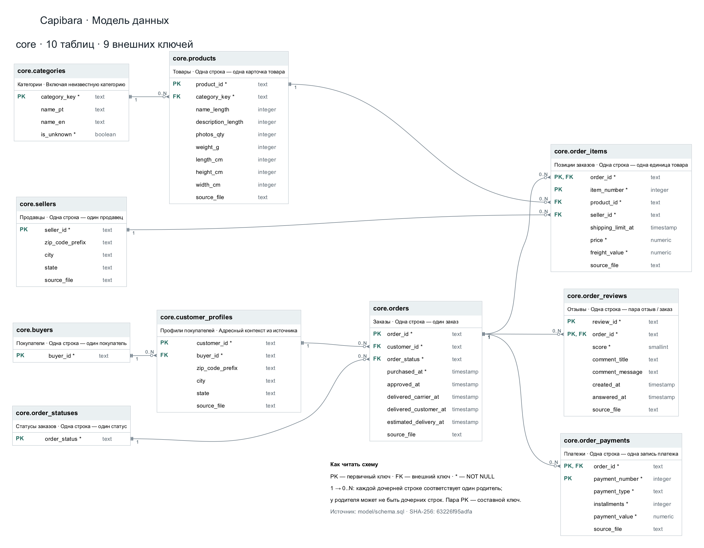

# Модель данных Capibara

ER-диаграмма существующей схемы `core`, построенная по [model/schema.sql](../model/schema.sql).
Она показывает 10 таблиц, все поля, первичные ключи и 9 внешних ключей.

[Открыть векторную схему SVG](images/model.svg) · [Открыть PNG](images/model.png)



## Как читать

- `PK` — первичный ключ. Несколько полей с `PK` образуют один составной ключ.
- `FK` — внешний ключ; соединительная линия ведёт к ключу родительской таблицы.
- `*` — обязательное поле (`NOT NULL`, в том числе поля первичного ключа).
- `1 → 0..N` — дочерняя строка имеет ровно одного родителя; у родительской строки может быть любое число дочерних, включая ноль. Это ограничения схемы, а не подсчитанное распределение данных.
- Поля без `*` допускают `NULL`. Уникальные ограничения, проверки `CHECK`, значения по умолчанию и индексы остаются в SQL-источнике.

## Сущности и уровень детализации

| Таблица | Одна строка | Первичный ключ |
|---|---|---|
| `buyers` | Покупатель, узнаваемый между заказами | `buyer_id` |
| `customer_profiles` | Профиль из источника с адресным контекстом заказа | `customer_id` |
| `orders` | Заказ | `order_id` |
| `order_statuses` | Допустимый статус из исходных данных | `order_status` |
| `order_items` | Единица товара внутри заказа | `order_id, item_number` |
| `products` | Карточка товара | `product_id` |
| `categories` | Категория, включая явную неизвестную | `category_key` |
| `sellers` | Продавец | `seller_id` |
| `order_payments` | Запись платежа заказа | `order_id, payment_number` |
| `order_reviews` | Связь отзыва с заказом | `review_id, order_id` |

`buyer_id` получается из `customer_unique_id` источника. `customer_id` идентифицирует профиль с адресным контекстом и не заменяет идентификатор покупателя. Схема допускает несколько заказов на один профиль; наблюдаемое соотношение в конкретной выгрузке не превращается в ограничение `UNIQUE`.

`item_number` — номер позиции, а не количество товара. Заказ может содержать товары разных продавцов. `review_id` встречается у нескольких заказов, поэтому сам по себе не служит первичным ключом `order_reviews`. Платёжная запись уже содержит полную сумму: `payment_value` не умножается на `installments`.

## Место в обработке данных

`raw → core → mart → SQL-ответы`

Восемь исходных таблиц `raw` сохраняются без изменений. [Загрузка core](../model/load.sql) приводит типы, выделяет покупателей и профили, строит справочники статусов и категорий. Диаграмма показывает физические связи `core`; зависимости витрин не являются внешними ключами.

В [model/marts.sql](../model/marts.sql) определены:

| Объект `mart` | Уровень результата и назначение |
|---|---|
| `order_summary` | Одна строка на заказ: товары, доставка, платежи, отзывы и сроки |
| `sales_items` | Единица товара из заказа со статусом `delivered` |
| `seller_sales` | Продавец с продажами: заказы, единицы и выручка |
| `category_sales` | Категория с продажами: выручка и её доля |
| `buyer_activity` | Покупатель: число заказов и период активности |
| `sales_by_month(start_month, end_month)` | Функция: месяц, число доставленных заказов и выручка, включая пустые месяцы |
| `quality_issues` | Выявленное замечание о качестве данных |

Позиции, платежи и отзывы — независимые дочерние факты заказа. Если напрямую соединить их друг с другом по `order_id`, строки перемножатся и суммы исказятся. В `mart.order_summary` каждая ветка сначала сводится до одной строки на заказ, затем результаты соединяются.

Деньги хранятся в `numeric`, валюта источника — BRL. Даты и время — исходные локальные `timestamp` без восстановленного по догадке часового пояса. Текущее `core` хранит бизнес-факты выгрузки; версионирование наборов и будущий SQL-интерфейс на диаграмме не показаны, поскольку ещё проектируются.

## Обновление диаграммы

Готовые изображения открываются без запуска БД и установки зависимостей. Чтобы пересобрать их после изменения DDL, нужны Python 3.10+ и [Graphviz](https://graphviz.org/):

```sh
make diagram
```

[scripts/render_model.py](../scripts/render_model.py) читает актуальный DDL, извлекает поля и ключи и создаёт SVG/PNG. Генератор рассчитан на текущий формат DDL и связи `1 → 0..N`; при изменении ограничений уникальности и кратностей его нужно актуализировать. Неизвестные таблицы или строки определений вызывают ошибку. Текстовые пояснения и подписи сущностей сверяются при изменении их смысла. Краткий SHA-256 источника указан на схеме.
