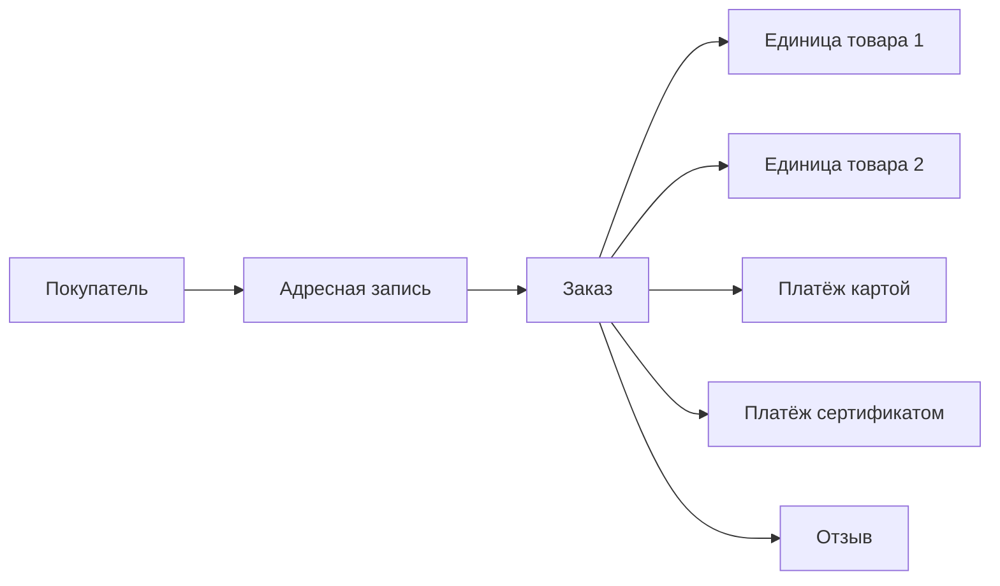

# Команде: как понять наше решение

Теперь доступны [выполненный notebook](../notebooks/01_data_investigation.ipynb),
[его HTML для браузера](../notebooks/01_data_investigation.html) и
[подробный план первого чекпоинта](submission/checkpoint_1.md).

## Сначала открой эту таблицу

В DBeaver: `marketplace → Schemas → mart → Views → order_totals`.
Правой кнопкой — «Просмотр данных / View Data». Одна строка — один заказ.
Имена пунктов могут отличаться в зависимости от языка и вида навигатора.

| Поле | Обычным языком |
|---|---|
| `order_id` | Номер заказа |
| `status_code` | Чем закончился заказ в текущей выгрузке |
| `purchased_at` | Когда оформлен |
| `units` | Сколько единиц товара; в исходнике столько же записей |
| `logical_lines` | Сколько групп одинаковых единиц по товару, продавцу, цене, доставке и сроку отгрузки |
| `goods_amount` | Сколько стоят товары без доставки |
| `freight_amount` | Сколько стоит доставка |
| `order_amount` | Товары плюс доставка: сумма, из которой считаем средний чек |
| `paid_amount` | Сколько записано в платёжной системе; иногда отличается |

`NULL` — значения нет/оно неизвестно. Например, заказ без позиций не даёт
доказанной суммы 0. Пустой месяц в календарном отчёте, наоборот, имеет
доказанно нулевую выручку при выбранных правилах.

Индексы, последовательности и ограничения — служебные объекты PostgreSQL.
Их можно свернуть. `raw` нужен для исследования источника, `core` — для
подробностей и связей, `mart` — для удобных отчётов.

## Как устроен обычный заказ



Человек может оформить несколько заказов и получить несколько исходных
`customer_id`. Устойчивый `customer_unique_id` объединяет эти записи,
а адрес каждого заказа сохраняется отдельно.

В заказе бывают разные товары и продавцы. Товары в `products` описывают
карточки; цена конкретной покупки лежит в `order_items`.
Платёж относится к заказу целиком, не к одной позиции.

## Почему нельзя склеить всё одним JOIN

Учебный пример без доставки: два товара по 100 и 50, два платежа по 120 и 30.

| Товар | Платёж после прямого JOIN |
|---|---|
| 100 | 120 |
| 100 | 30 |
| 50 | 120 |
| 50 | 30 |

Сумма товаров получается 300 вместо 150. SQL выполнен успешно, ответ неверный.
Поэтому `mart.order_totals` отдельно суммирует позиции по заказу, отдельно
платежи по заказу и только потом соединяет по одной строке.

В [team_walkthrough.sql](team_walkthrough.sql) есть такой же пример на
реальном заказе. Скрипт только читает данные, его безопасно выполнять
блоками в DBeaver.

## За что отвечают 11 таблиц core

| Таблица | Одна строка | Зачем отдельно |
|---|---|---|
| `customers` | Человек | Повторные оформления по устойчивому ID |
| `customer_order_profiles` | Исходная запись покупателя с адресом | Не терять адресный контекст конкретного заказа |
| `orders` | Заказ любого статуса | Хранить хронологию и статус без повторения по товарам |
| `order_items` | Одна единица товара | Считать товары, продавцов, категории и доставку |
| `order_payments` | Платёжная запись | Учитывать смешанную оплату без размножения товаров |
| `order_reviews` | Запись отзыва | Несколько отзывов не должны менять выручку |
| `products` | Карточка товара | Описание, габариты, категория |
| `categories` | Категория с постоянным ID в этой базе | Сохранять группу без категории и переводы |
| `sellers` | Продавец | Его собственная география |
| `order_statuses` | Статус и признак delivered | Единое правило включения в выручку |
| `payment_types` | Способ оплаты | Новые способы не ломают модель |

После обновления метаданных DBeaver у таблиц и колонок доступны русские
комментарии. Их также показывает последний запрос `team_walkthrough.sql`.
Комментарии не меняют названия полей, поэтому SQL команды остаётся единым.

## Какие решения уже приняты

- Выручка кейса — товары доставленных заказов **без доставки**.
- Средний чек — среднее сумм заказов **с доставкой**.
- Повторные оформления в вопросе 4 — заказы всех статусов по человеку.
  Это определение совпадает с контролем, но не доказывает повторную успешную покупку.
- `order_item_id` уникален только внутри заказа; ключ состоит из двух полей.
- `review_id` повторяется; в текущем источнике уникальна пара review/order.
- Нет категории — отдельная группа; нет перевода — сохраняем исходное имя.
- Странные даты и расхождения платежей не исправляем догадками:
  ищем их в `mart.quality_issues` по идентификатору.

## Что происходит при новых данных

| Изменение | Поведение сборки |
|---|---|
| Добавлена категория | Получает новый ID; прежние ID сохраняются |
| Категория исчезла и вернулась | Её соответствие остаётся и используется снова |
| Появился перевод категории | Обновляется перевод, ID остаётся |
| Новый статус | Сохраняется с предупреждением, автоматически в выручку не входит |
| Новый тип платежа | Сохраняется с предупреждением, его сумма учитывается |
| Несколько разных платежей заказа | Сохраняются все, стоимость товаров не размножается |
| Дубликат ключа платежа/отзыва | Сборка останавливается; строки не удаляются произвольно |
| Неверная дата, пустой обязательный ключ, потерянная связь | Понятная ошибка до очистки модели |

Постоянство category_id действует в пределах сохранённой базы. Для переноса
соответствий на другую базу нужен backup/перенос справочника. Имена категорий
пока служат исходными ключами: переименование без постоянного ID источника
трактуется как новая категория. Неиспользуемые категории остаются в справочнике,
но в продажи попадают только через фактические позиции.

## Команды из корня репозитория

```bash
# Собрать рабочую модель из уже загруженного raw
.venv/bin/python scripts/build_model.py

# Проверить изменённые данные: отдельная временная база, потом удаляется
.venv/bin/python scripts/check_scenarios.py

# Проверить контрольные ответы, повторную сборку и откат на полном Olist
.venv/bin/python scripts/check_model.py

# Обновить CSV с результатами
.venv/bin/python scripts/export_answers.py
```

Сборка перезаписывает факты core. Проверки изменённых данных не затрагивают
рабочий raw. Полная проверка Olist пересобирает рабочий core, сохраняя raw.
Тестовой базе требуется право CREATEDB; у локального пользователя `hack` оно есть.

## Как объяснить работу на защите за минуту

«Мы выделили разные сущности маркетплейса и сохранили все статусы и позиции.
Покупателей связали по устойчивому ID, адрес оставили у исходного профиля.
Позиции и платежи агрегируем отдельно, чтобы соединения не завышали суммы.
Сборка проверяет источник и перенос в одной транзакции, при ошибке откатывается.
Неоднозначности источника доступны с ID в диагностике.
Пять контрольных отчётов сошлись, а сценарные тесты проверили изменения данных».

Полная модель и правила — [README команды](README.md).
Материалы защиты — [submission/defense.md](submission/defense.md).
Самостоятельная подготовка участника: выполнить обзорный SQL, объяснить
разницу `goods_amount`/`order_amount` и показать, что случится при ошибочном JOIN.
